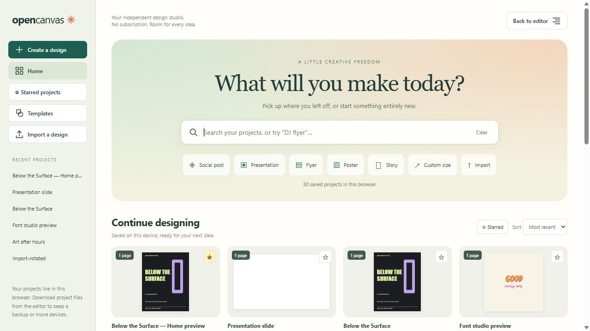
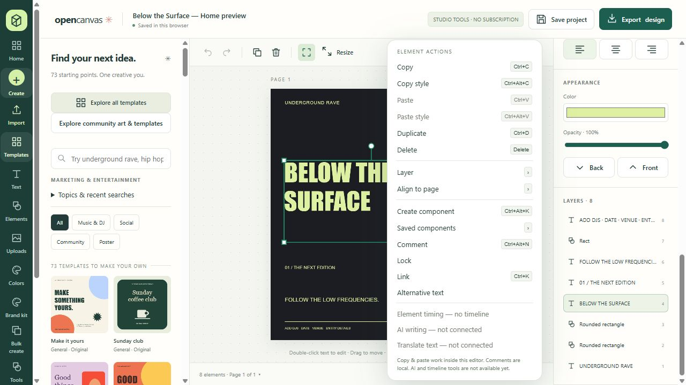

# OpenCanvas

**An independent, subscription-free design editor. Actively being built.**

Created and directed by **Mathew Minguel**, with development assistance from **OpenAI Codex**. OpenCanvas is an ongoing project, not a finished replacement for every commercial design tool. It is independently implemented and is not affiliated with Canva.



## Open the app

**[Launch OpenCanvas in your browser](https://mobming.github.io/opencanvas/)** — no installation or local server required.

Projects are saved in the browser where you create them. To move an existing design from another OpenCanvas address, export its `.opencanvas` project file there, then import it at the new address.

## Run on your own computer (optional)

The `127.0.0.1` address below means **your own computer**, not the public website. It only works while the local server is running. For a normal online visit, use the **Launch OpenCanvas** link above.

Install Node.js 24 or later, download or clone this repository, open a terminal in its folder, and run:

```sh
node server.mjs
```

Keep that terminal open, then open **http://127.0.0.1:4173/**. On Windows, you can instead double-click `Start-OpenCanvas.cmd` in the downloaded project folder. If you see "connection refused," start the server first and reload the page. Closing the server or restarting your computer stops the local app; run it again to reopen it.

The application ships ready to run in `dist/index.html`; no dependency installation or build step is needed. A recent desktop browser is recommended.

The [original hosted preview](https://opencanvas-studio.cocoa-lotus-4165.chatgpt.site/) may require access from its owner. The custom `www.opencanvas.com` address is not an active project address yet.

## What works today

- Home with recent projects, previews, favorites, sorting, and search.
- Text, shapes, uploaded images, editable layers, undo/redo, snapping, and alignment.
- 1,213 template entries, including 240 Reference Remix combinations, 16 Lifestyle & Events, 24 Studio Mix and 20 People & Culture designs, with 38 original generated photo/art assets. Default browsing shows 445 design cards, grouping older style and size variations; enable Show all variations to see every entry.
- People-focused campaign layouts with labeled AI imagery, format/style filters, and replaceable photo layers. See [template sources and research](docs/TEMPLATE-SOURCES.md).
- 36 font combinations, bundled open fonts, text effects, and saved styles.
- Multipage designs, local presentations, and PNG, JPG, flattened PDF, and editable project exports.
- PDF/image imports from Canva or other tools, preserved as flat artwork with editable overlays.
- Drawing tools, charts, image adjustments, simple background removal, resizing, and CSV bulk creation.
- Brand kits and a local business workspace for campaigns, review stages, and imported ad reports.
- Right-click copy/paste, style transfer, layer order, page alignment, locking, links, descriptions, local comments, and reusable single-element components.



## Important limits

Your designs are saved **in your browser on this device**. Download `.opencanvas` project backups regularly. Different browsers, devices, ports, and website addresses have separate storage; moving to another address does not automatically move your projects.

This is a static browser application. It does not provide cloud accounts, shared editing, online comments, connected ad accounts, automatic social publishing, AI writing, automatic translation, or a video timeline. Some format presets are static mockups or storyboards. Imported PDF/image artwork does not become separately editable text and shapes. Current PDF output is rasterized.

Element links and descriptions stay in editable project files; current image/PDF exports do not preserve clickable links or accessibility metadata. Saved components insert independent copies, not synchronized instances.

## Development

```sh
npm test
npm run check
```

These commands need no third-party packages. The current baseline contains **76 automated checks**. See [development notes](docs/DEVELOPMENT.md) for source layout and the order for rebuilding feature modules.

The standalone HTML currently also contains the original editor core. Separating that core from the generated bundle is on the [roadmap](ROADMAP.md).

## Credits and reuse

See [CREDITS.md](CREDITS.md) for project credits and [THIRD_PARTY_NOTICES.md](THIRD_PARTY_NOTICES.md) for asset and dependency notices. Original third-party licenses and source records are included.

**A project-wide reuse license has not yet been selected.** This publication does not replace the licenses of included third-party material. See [RIGHTS.md](RIGHTS.md). Contributions are welcome as discussion and proposals while the maintainer chooses a contribution and licensing policy.

## Still in progress

This repository is the starting point for continued development, not a final release. Use [ROADMAP.md](ROADMAP.md) to see the next areas of work and [CONTRIBUTING.md](CONTRIBUTING.md) before proposing changes. Please use made-up sample content in public issue reports rather than uploading private designs or client information.

The Design Combinations pack adds 120 theme/style combinations and 24 original editable symbols. Browse with the Collection and Layout filters; find the symbols under Elements. These are original compositions inspired by broad design directions, with references documented in [design research](docs/DESIGN-COMBINATIONS.md). Existing photo assets are reused; no new photo shoots or downloaded Pinterest graphics are claimed.

