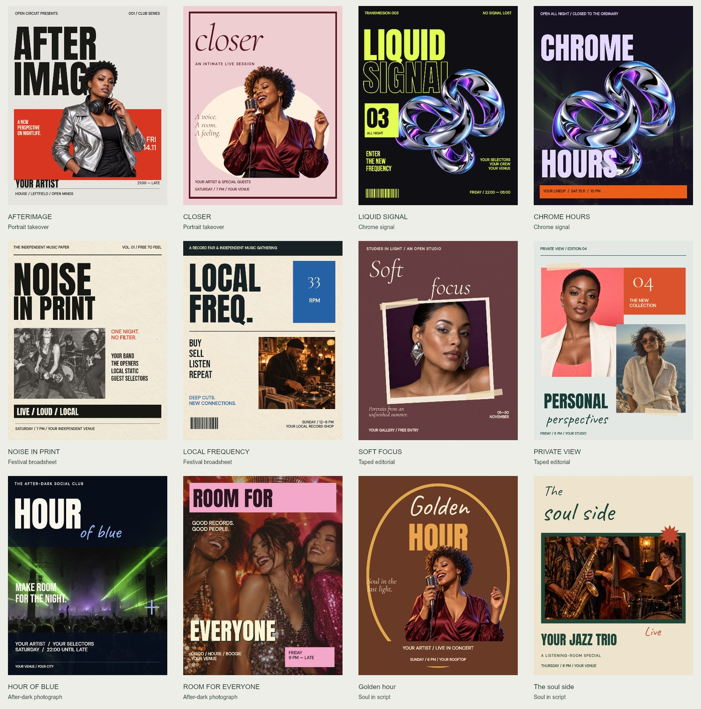

# Art Directed release

This release focuses on composition quality and useful editing workflows. It adds 24 independently composed templates and rebuilds the 36 existing Flyer Lab templates while preserving their IDs, titles, topics, and source imagery. Existing saved projects keep their own artwork; template updates do not rewrite them.

## Designs

The 24 new designs span twelve art directions: portrait takeover, chrome signal, festival broadsheet, taped editorial, after-dark photography, soul in script, fashion masthead, guest-list ephemera, gallery archive, artist dossier, record culture, and cinematic campaigns. Both designs in each direction have different compositions. They are not 24 palette permutations of one layout.

Six new assets supply transparent foreground people, a chrome sculpture, paper grain, and a full-bleed warehouse scene. They join the previously credited imagery. Text and geometric shapes remain native editable layers; photos and textures are replaceable image layers.

- [Visual assets and exact prompts](../assets/atelier/PROVENANCE.json), generated with OpenAI's built-in image tool.
- [Open font files, source URLs, and checksums](../vendor/fonts/ATELIER-SOURCES.json). Anton, Bebas Neue, DM Sans, Cormorant Garamond, and Caveat are bundled unmodified with their SIL Open Font License notices.
- [Artwork origins](ARTWORK.md) and [third-party notices](../THIRD_PARTY_NOTICES.md).

## Finding and using designs

Open **Templates**, then **Art directed** in the Collection filter or the featured collection button. The initial unfiltered gallery highlights new designs and then continues into the mixed library. Search, topic, style, format, image type, and layout filters still work together.

Click a card for a larger preview. The preview shows its page size and counts of editable text, image, and shape layers. **Use template** creates the design; **Back to templates** closes the preview without replacing the current canvas. Bookmark buttons save templates in this browser, and **Saved** filters the gallery to them.

The gallery uses variable-height columns to avoid empty gaps beneath short cards. Cards retain their original DOM order for keyboard and screen-reader traversal. Loading more keeps the current ordering stable.

## Customizing imagery and type

Select an image and open **Photo studio**. Duotone maps dark and light tones to two chosen colors; seven presets, custom shadow/highlight colors, and an intensity control are available. **Original / reset** returns to the retained source. After applying, the source and settings remain in the editable project so the effect can be reopened. Undo restores the previous layer.

Photo processing is limited to 1600 pixels. Retaining original image data increases the size of local projects and backups. Replacing or modifying image pixels through another tool invalidates those earlier Photo Studio settings rather than applying them to the wrong source.

The Text panel includes eight additional font combinations. Headlines, letter spacing, and line height use consistent measurement when templates are fitted, including large condensed titles.

## Scope

The [public Canva comparison](CANVA-COMPARISON.md) records the researched workflows and remaining gaps. This release does not claim that every older template has been regenerated or that OpenCanvas implements every Canva feature. Curved text, semantic AI editing, commercial stock catalogs, full video editing, and connected team/social workflows still have the limits described in that document. No Canva source code, paid template files, or licensed stock artwork was imported.

